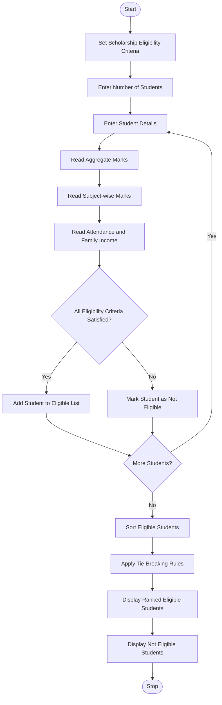

# University Scholarship Allocation System Using Python

## 1\. Problem Statement

The University Scholarship Allocation System is designed to evaluate and rank students based on predefined scholarship eligibility criteria.

The system considers the following factors:

1. **Aggregate Marks:** Students must obtain the minimum overall percentage required for the scholarship.
2. **Subject-wise Minimum Marks:** Students must secure the minimum marks in each required subject.
3. **Attendance:** Students must meet the minimum attendance percentage.
4. **Family Annual Income:** Students whose family income is within the specified income limit are eligible.

After checking all eligibility conditions, the system ranks eligible students based on their aggregate marks.

**Tie-breaking rules:**

- Students with higher aggregate marks receive higher priority.
- If aggregate marks are equal, students with higher attendance receive priority.
- If both aggregate marks and attendance are equal, students with lower family income receive priority.

The system displays the list of eligible students in ranked order along with their scholarship eligibility status.

## 2\. Algorithm

1. Start the program.
2. Define the minimum eligibility criteria:
   - Minimum aggregate marks = 75%.
   - Minimum subject marks = 60%.
   - Minimum attendance = 75%.
   - Maximum annual family income = ₹2,50,000.
3. Enter the number of students.
4. For each student, input:
   - Student name.
   - Aggregate marks.
   - Subject-wise marks.
   - Attendance percentage.
   - Annual family income.
5. Check whether the student satisfies all eligibility conditions.
6. If all conditions are satisfied, add the student to the eligible list.
7. Otherwise, mark the student as not eligible.
8. Sort eligible students based on:
   - Higher aggregate marks.
   - Higher attendance.
   - Lower family income.
9. Display the ranked list of eligible students.
10. Display students who are not eligible.
11. Stop the program.

## 3\. Flowchart (Mermaid Code)



## 4\. Python Source Code

python

```
# University Scholarship Allocation System

# Scholarship Eligibility Criteria
MIN_AGGREGATE = 75
MIN_SUBJECT = 60
MIN_ATTENDANCE = 75
MAX_INCOME = 250000

eligible_students = []
not_eligible_students = []

# Input number of students
n = int(input("Enter number of students: "))

for i in range(n):

    print("\nEnter details of Student", i + 1)

    name = input("Enter student name: ")

    aggregate = float(input("Enter aggregate marks (%): "))

    # Subject-wise marks
    subjects = []
    num_subjects = int(input("Enter number of subjects: "))

    for j in range(num_subjects):
        marks = float(input(
            f"Enter marks for subject {j + 1}: "
        ))
        subjects.append(marks)

    attendance = float(
        input("Enter attendance percentage: ")
    )

    income = float(
        input("Enter annual family income: ")
    )

    # Check eligibility
    if (aggregate >= MIN_AGGREGATE and
        all(m >= MIN_SUBJECT for m in subjects) and
        attendance >= MIN_ATTENDANCE and
        income <= MAX_INCOME):

        eligible_students.append({
            "name": name,
            "aggregate": aggregate,
            "attendance": attendance,
            "income": income
        })

    else:
        not_eligible_students.append(name)

# Sort eligible students
# Priority:
# 1. Higher aggregate marks
# 2. Higher attendance
# 3. Lower family income

eligible_students.sort(
    key=lambda x: (
        -x["aggregate"],
        -x["attendance"],
        x["income"],
        x["name"].lower()
    )
)

# Display eligible students
print("\n========== SCHOLARSHIP RANK LIST ==========")

if eligible_students:

    for rank, student in enumerate(
        eligible_students, start=1
    ):

        print("\nRank:", rank)
        print("Name:", student["name"])
        print("Aggregate Marks:", student["aggregate"])
        print("Attendance:", student["attendance"])
        print("Annual Income: Rs.", student["income"])
        print("Status: ELIGIBLE")

else:
    print("No students are eligible for scholarship.")

# Display not eligible students
print("\n========== NOT ELIGIBLE STUDENTS ==========")

if not_eligible_students:

    for name in not_eligible_students:
        print(name, "- NOT ELIGIBLE")

else:
    print("All students are eligible.")

print("\nScholarship Allocation Process Completed.")
```

## 5\. Sample Input

text

```
Enter number of students: 4

Enter details of Student 1
Enter student name: Rahul
Enter aggregate marks (%): 90
Enter number of subjects: 3
Enter marks for subject 1: 85
Enter marks for subject 2: 90
Enter marks for subject 3: 88
Enter attendance percentage: 92
Enter annual family income: 200000

Enter details of Student 2
Enter student name: Priya
Enter aggregate marks (%): 95
Enter number of subjects: 3
Enter marks for subject 1: 90
Enter marks for subject 2: 95
Enter marks for subject 3: 92
Enter attendance percentage: 90
Enter annual family income: 180000

Enter details of Student 3
Enter student name: Arjun
Enter aggregate marks (%): 80
Enter number of subjects: 3
Enter marks for subject 1: 75
Enter marks for subject 2: 80
Enter marks for subject 3: 78
Enter attendance percentage: 85
Enter annual family income: 220000

Enter details of Student 4
Enter student name: Sneha
Enter aggregate marks (%): 70
Enter number of subjects: 3
Enter marks for subject 1: 65
Enter marks for subject 2: 70
Enter marks for subject 3: 68
Enter attendance percentage: 80
Enter annual family income: 150000
```

## 6. Sample Output

text

```
========== SCHOLARSHIP RANK LIST ==========

Rank: 1
Name: Priya
Aggregate Marks: 95.0
Attendance: 90.0
Annual Income: Rs. 180000.0
Status: ELIGIBLE

Rank: 2
Name: Rahul
Aggregate Marks: 90.0
Attendance: 92.0
Annual Income: Rs. 200000.0
Status: ELIGIBLE

Rank: 3
Name: Arjun
Aggregate Marks: 80.0
Attendance: 85.0
Annual Income: Rs. 220000.0
Status: ELIGIBLE

========== NOT ELIGIBLE STUDENTS ==========

Sneha - NOT ELIGIBLE

Scholarship Allocation Process Completed.
```

## 7\. Result

Thus, the University Scholarship Allocation System was successfully implemented using Python.

The program evaluates students based on aggregate marks, subject-wise minimum marks, attendance percentage, and annual family income. It identifies eligible students, ranks them according to predefined priority rules, and resolves ties using attendance and family income.

**The system provides a simple, transparent, and efficient method for university scholarship allocation.**In this you have to write the algorithm,flowchart,python source code,sample input,sample output,and the flow chart in mermaid
