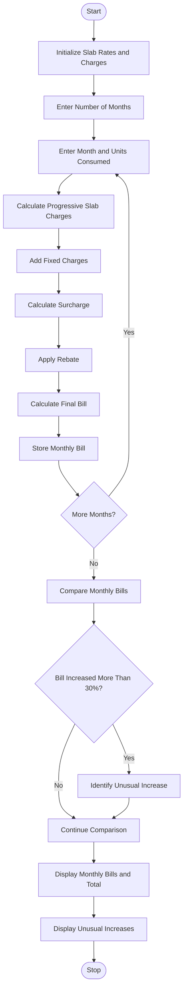

# Progressive Electricity Billing System Using Python

## 1\. Problem Statement

Develop a Python program to calculate household electricity bills based on multiple electricity consumption slabs. The program should consider:

- **Units Consumed:** Total electricity units used by the household.
- **Slab Rates:** Different charges for different consumption ranges.
- **Fixed Charges:** A fixed amount added to every electricity bill.
- **Surcharges:** Additional charges calculated on the electricity bill.
- **Rebates:** Discounts provided to eligible households.
- **Monthly Comparison:** Compare electricity bills across several months.
- **Unusual Increase Detection:** Identify months where the electricity bill increases significantly compared to the previous month.

The program should display the monthly electricity bill, total amount payable, and unusual increases in electricity consumption costs.

## 2\. Algorithm

1. Start the program.
2. Initialize electricity slab rates, fixed charges, surcharge percentage, and rebate percentage.
3. Ask the user to enter the number of months.
4. For each month:
   - Enter the month name.
   - Enter the number of electricity units consumed.
   - Calculate electricity charges using progressive slab rates.
   - Add fixed charges.
   - Calculate the surcharge.
   - Apply the eligible rebate.
   - Calculate the final electricity bill.
5. Store monthly consumption and bill amounts.
6. Compare each month's bill with the previous month's bill.
7. Identify unusual increases if the bill increases by more than 30%.
8. Display monthly electricity consumption and bill details.
9. Display the total electricity bill for all months.
10. Display months with unusual increases.
11. Stop.

## 3\. Flowchart (Mermaid Code)




## 4\. Source Code (Python)

python

```python
# Progressive Electricity Billing System

# Electricity slab rates
SLAB1 = 3.00       # 0-100 units
SLAB2 = 5.00       # 101-200 units
SLAB3 = 7.00       # 201-300 units
SLAB4 = 10.00      # Above 300 units

# Fixed charges and percentages
FIXED_CHARGE = 50
SURCHARGE_RATE = 5
REBATE_RATE = 5

# Function to calculate electricity charges
def calculate_bill(units):

    if units <= 100:
        energy_charge = units * SLAB1

    elif units <= 200:
        energy_charge = (100 * SLAB1) + \
                        ((units - 100) * SLAB2)

    elif units <= 300:
        energy_charge = (100 * SLAB1) + \
                        (100 * SLAB2) + \
                        ((units - 200) * SLAB3)

    else:
        energy_charge = (100 * SLAB1) + \
                        (100 * SLAB2) + \
                        (100 * SLAB3) + \
                        ((units - 300) * SLAB4)

    # Add fixed charges
    subtotal = energy_charge + FIXED_CHARGE

    # Calculate surcharge
    surcharge = subtotal * SURCHARGE_RATE / 100

    # Calculate rebate
    rebate = subtotal * REBATE_RATE / 100

    # Final bill
    total_bill = subtotal + surcharge - rebate

    return energy_charge, surcharge, rebate, total_bill

# Main program
months = []

n = int(input("Enter number of months: "))

for i in range(n):

    print("\nMonth", i + 1)

    month = input("Enter month name: ")
    units = float(input("Enter electricity units consumed: "))

    if units < 0:
        print("Invalid units! Enter a non-negative value.")
        continue

    energy, surcharge, rebate, bill = calculate_bill(units)

    months.append({
        "month": month,
        "units": units,
        "energy": energy,
        "surcharge": surcharge,
        "rebate": rebate,
        "bill": bill
    })

# Display monthly bills
print("\n========== ELECTRICITY BILL REPORT ==========")

for data in months:

    print("\nMonth:", data["month"])
    print("Units Consumed:", data["units"])
    print("Energy Charges: Rs.", round(data["energy"], 2))
    print("Fixed Charges: Rs.", FIXED_CHARGE)
    print("Surcharge: Rs.", round(data["surcharge"], 2))
    print("Rebate: Rs.", round(data["rebate"], 2))
    print("Final Bill: Rs.", round(data["bill"], 2))

# Calculate total bill
total = sum(data["bill"] for data in months)

print("\nTotal Electricity Bill: Rs.", round(total, 2))

# Compare monthly bills
print("\n========== MONTHLY BILL COMPARISON ==========")

for i in range(1, len(months)):

    previous = months[i - 1]["bill"]
    current = months[i]["bill"]

    if previous == 0:
        increase = 0
    else:
        increase = ((current - previous) / previous) * 100

    print("\n", months[i - 1]["month"],
          "to", months[i]["month"])

    print("Bill Change:", round(increase, 2), "%")

    if increase > 30:
        print("WARNING: Unusual increase detected!")
    else:
        print("Normal bill variation.")

print("\n========== END OF REPORT ==========")
```

## 5\. Sample Input

text

```text
Enter number of months: 4

Month 1
Enter month name: January
Enter electricity units consumed: 80

Month 2
Enter month name: February
Enter electricity units consumed: 120

Month 3
Enter month name: March
Enter electricity units consumed: 180

Month 4
Enter month name: April
Enter electricity units consumed: 300
```

## 6\. Sample Output

text

```text
========== ELECTRICITY BILL REPORT ==========

Month: January
Units Consumed: 80.0
Energy Charges: Rs. 240.0
Fixed Charges: Rs. 50
Surcharge: Rs. 14.5
Rebate: Rs. 14.5
Final Bill: Rs. 290.0

Month: February
Units Consumed: 120.0
Energy Charges: Rs. 400.0
Fixed Charges: Rs. 50
Surcharge: Rs. 22.5
Rebate: Rs. 22.5
Final Bill: Rs. 450.0

Month: March
Units Consumed: 180.0
Energy Charges: Rs. 700.0
Fixed Charges: Rs. 50
Surcharge: Rs. 37.5
Rebate: Rs. 37.5
Final Bill: Rs. 750.0

Month: April
Units Consumed: 300.0
Energy Charges: Rs. 1500.0
Fixed Charges: Rs. 50
Surcharge: Rs. 77.5
Rebate: Rs. 77.5
Final Bill: Rs. 1550.0

Total Electricity Bill: Rs. 3040.0

========== MONTHLY BILL COMPARISON ==========

January to February
Bill Change: 55.17 %
WARNING: Unusual increase detected!

February to March
Bill Change: 66.67 %
WARNING: Unusual increase detected!

March to April
Bill Change: 106.67 %
WARNING: Unusual increase detected!

========== END OF REPORT ==========
```

## 7\. Expected Result

The Progressive Electricity Billing System successfully calculates household electricity bills using multiple consumption slabs, fixed charges, surcharges, and rebates.

It also:

- Calculates electricity charges based on consumed units.
- Generates monthly electricity bills.
- Compares bills across multiple months.
- Detects unusual increases greater than 30%.
- Displays the total electricity expenses.

**Conclusion:** This Python project helps households monitor electricity consumption, understand monthly billing changes, and identify unusually high electricity bills.

**Note:** The slab rates and charges used in this program are sample values for an academic project, not official electricity tariff rates.
