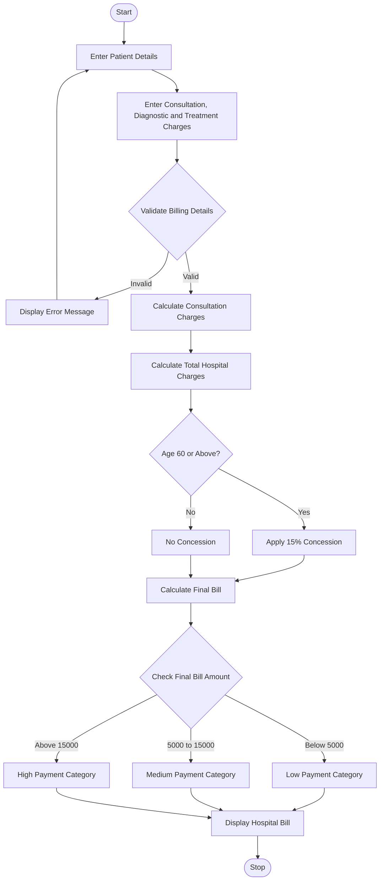

# Hospital Billing and Patient Classification System Using Python

## 1\. Problem Statement

Develop a Python program to calculate hospital bills based on consultation charges, diagnostic charges, and treatment charges. The system should apply conditional concessions based on patient category and validate billing constraints.

The program should also classify patients according to their total bill amount and payment policy.

The system performs the following operations:

- **Consultation Charges:** Calculate fees for doctor consultations.
- **Diagnostic Charges:** Calculate charges for laboratory tests, X-rays, scans, etc.
- **Treatment Charges:** Calculate treatment and medical procedure costs.
- **Conditional Concessions:** Apply discounts for eligible patients, such as senior citizens.
- **Billing Validation:** Ensure that charges and discounts are valid and non-negative.
- **Patient Classification:** Classify patients based on their payment category.
- **Final Bill Generation:** Display the total amount payable by the patient.

## 2\. Algorithm

1. Start the program.
2. Initialize consultation, diagnostic, and treatment charges.
3. Enter patient details:
   - Patient ID
   - Patient name
   - Age
   - Number of consultations
   - Diagnostic charges
   - Treatment charges
4. Validate the entered details.
5. Calculate consultation charges.
6. Calculate the total hospital charges:Total = Consultation Charges + Diagnostic Charges + Treatment Charges
7. Check patient eligibility for concessions.
8. Apply the appropriate concession:
   - Senior citizens (age 60 and above): 15% discount.
   - Other patients: No discount.
9. Calculate the final bill after concession.
10. Classify the patient according to the payment policy:
    - Below ₹5,000: Low Payment Category.
    - ₹5,000 to ₹15,000: Medium Payment Category.
    - Above ₹15,000: High Payment Category.
11. Display patient details, charges, concession, and final bill.
12. Stop the program.

## 3\. Flowchart with Mermaid Code

mermaid



## 4\. Source Code (Python)


```python
# Hospital Billing and Patient Classification System

# Fixed consultation fee
CONSULTATION_FEE = 500

# Function to calculate hospital bill
def calculate_bill(age, consultations, diagnostic, treatment):

    # Calculate consultation charges
    consultation_charge = consultations * CONSULTATION_FEE

    # Calculate total charges
    total = consultation_charge + diagnostic + treatment

    # Apply conditional concession
    if age >= 60:
        concession = total * 15 / 100
    else:
        concession = 0

    # Calculate final bill
    final_bill = total - concession

    return consultation_charge, total, concession, final_bill

# Function to classify patient
def classify_patient(amount):

    if amount < 5000:
        return "Low Payment Category"

    elif amount <= 15000:
        return "Medium Payment Category"

    else:
        return "High Payment Category"

# Main program
print("===== HOSPITAL BILLING SYSTEM =====")

# Enter patient details
patient_id = input("Enter Patient ID: ")
patient_name = input("Enter Patient Name: ")

age = int(input("Enter Patient Age: "))

consultations = int(input("Enter Number of Consultations: "))

diagnostic = float(input("Enter Diagnostic Charges: Rs. "))

treatment = float(input("Enter Treatment Charges: Rs. "))

# Validate billing constraints
if age <= 0:
    print("Invalid Age!")

elif consultations < 0:
    print("Invalid Number of Consultations!")

elif diagnostic < 0 or treatment < 0:
    print("Charges cannot be negative!")

else:

    # Calculate bill
    consultation, total, concession, final_bill = calculate_bill(
        age, consultations, diagnostic, treatment
    )

    # Classify patient
    category = classify_patient(final_bill)

    # Display bill
    print("\n===== HOSPITAL BILL DETAILS =====")

    print("Patient ID:", patient_id)
    print("Patient Name:", patient_name)
    print("Patient Age:", age)

    print("\nConsultation Charges: Rs.", consultation)
    print("Diagnostic Charges: Rs.", diagnostic)
    print("Treatment Charges: Rs.", treatment)

    print("\nTotal Charges: Rs.", total)
    print("Concession: Rs.", concession)
    print("Final Bill Amount: Rs.", final_bill)

    print("\nPatient Classification:", category)

    print("\n===== BILL GENERATED SUCCESSFULLY =====")
```

## 5\. Sample Input

text

```text
===== HOSPITAL BILLING SYSTEM =====

Enter Patient ID: 101
Enter Patient Name: Rahul
Enter Patient Age: 65
Enter Number of Consultations: 2
Enter Diagnostic Charges: Rs. 3000
Enter Treatment Charges: Rs. 8000
```

## 6\. Sample Output

text

```text
===== HOSPITAL BILL DETAILS =====

Patient ID: 101
Patient Name: Rahul
Patient Age: 65

Consultation Charges: Rs. 1000
Diagnostic Charges: Rs. 3000
Treatment Charges: Rs. 8000

Total Charges: Rs. 12000
Concession: Rs. 1800
Final Bill Amount: Rs. 10200

Patient Classification: Medium Payment Category

===== BILL GENERATED SUCCESSFULLY =====
```

## 7\. Additional Test Cases

| Patient Age | Total Charges | Concession | Final Bill | Classification |
| --- | --- | --- | --- | --- |
| 25 | ₹3,000 | ₹0 | ₹3,000 | Low |
| 65 | ₹12,000 | ₹1,800 | ₹10,200 | Medium |
| 45 | ₹18,000 | ₹0 | ₹18,000 | High |
| 70 | ₹20,000 | ₹3,000 | ₹17,000 | High |

## 8\. Expected Result

The Hospital Billing and Patient Classification System successfully:

1. Calculates consultation charges.
2. Calculates diagnostic and treatment charges.
3. Applies conditional concessions to eligible senior citizens.
4. Validates patient and billing information.
5. Calculates the final hospital bill.
6. Classifies patients into low, medium, and high payment categories.
7. Generates a detailed hospital bill.

## 9\. Conclusion

The Hospital Billing and Patient Classification System is a Python-based application that simplifies hospital billing operations. It reduces manual calculation errors, applies eligible concessions automatically, validates billing constraints, and classifies patients according to their final payable amount.

**Note:** The consultation fee, concession percentage, and payment classification limits are sample values for an academic project. They can be modified according to the hospital's actual billing and payment policies.
